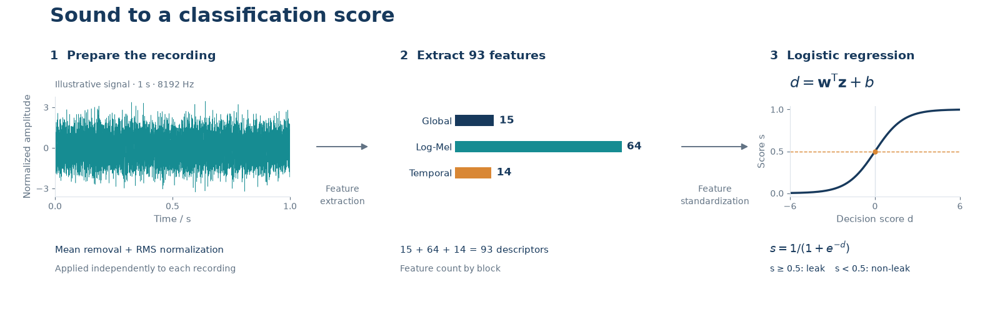

# Acoustic Leak Baseline

Classify one-second pipe sounds with 93 acoustic features and logistic regression.
Train on labeled recordings and evaluate on clips from held-out recording groups.



[Vector figure](assets/overview.svg)

## Quick start

Run the simulated example in a Python 3.11+ virtual environment.

```bash
git clone https://github.com/ox10cx10/acoustic-leak-baseline.git
cd acoustic-leak-baseline
python -m pip install -e .
python -m examples.synthetic
```

The example generates 48 clips across 12 simulated recording conditions. It prints
the out-of-fold confusion matrix, then fits all 48 clips and scores a new one.

## Use your recordings

Supply three arrays:

| Array | Shape | Meaning |
|---|---|---|
| `signals` | `(n, 8192)` | One-second mono waveforms sampled at 8192 Hz |
| `labels` | `(n,)` | `0`: non-leak; `1`: leak |
| `groups` | `(n,)` | Nonempty strings identifying the original recording or acquisition source |

Give all clips from the same recording the same group ID. To evaluate transfer
to new sites, use the site as the group instead. Keep duplicate waveforms together.

```python
import numpy as np
from acoustic_leak import cross_validate, make_pipeline

with np.load("recordings.npz", allow_pickle=False) as data:
    signals, labels, groups = data["signals"], data["labels"], data["groups"]

cv = cross_validate(signals, labels, groups, C=0.1, n_splits=3)
print(cv["metrics"])

model = make_pipeline(C=0.1).fit(signals, labels)
new_clips = np.load("new_clips.npy", allow_pickle=False)
scores = model.predict_proba(new_clips)[:, 1]
predicted_labels = (scores >= 0.5).astype(int)
```

`cross_validate` returns one out-of-fold score and fold ID per clip, plus metrics
pooled across clips. Each training and validation fold needs both classes.
When comparing values of `C`, reserve separate recording groups for the final test.

## Feature recipe

| Block | Dimensions | Description |
|---|---:|---|
| Global shape and spectrum | 15 | Crest factor and its logarithm, zero crossings, six spectral descriptors, six band-energy fractions |
| Log-Mel statistics | 64 | Means and standard deviations of 32 log-Mel bands |
| Temporal variation | 14 | Frame energy, spectral flux, centroid, flatness, peak concentration, and band-energy variation |

For each waveform, subtract its mean and divide by its RMS. Compute the short-time
spectrum with a 256-sample Hann window, a 128-sample hop and unpadded frames.
The Mel bands span 20–4096 Hz.

The scaler and classifier are fitted on each training fold. Logistic regression
uses balanced class weights, L2 regularization and the Newton-CG solver.
Smaller `C` gives stronger regularization. The default is `C=1`.

To inspect the feature matrix and its ordered column names:

```python
from acoustic_leak import extract_features
features, names = extract_features(signals)
assert features.shape == (len(signals), 93)
```

## Scores and evaluation

The default threshold assigns class 1 (leak) at scores of 0.5 or higher.
Scores come from the class-weighted fit. To score a labeled test set:

```python
from acoustic_leak import evaluate
metrics = evaluate(y_test, model.predict_proba(X_test)[:, 1])
```

The confusion matrix gives true classes by row and predictions by column, in
the order `[non-leak, leak]`. The other metrics are accuracy, balanced accuracy,
leak recall, false-positive rate, false-negative rate and ROC AUC.

## Save and load

Save the complete pipeline so that the fitted scaler travels with the classifier:

```python
import joblib
joblib.dump(model, "model.joblib")
restored = joblib.load("model.joblib")
scores = restored.predict_proba(new_clips)[:, 1]
```

Load trusted model files with the package and dependency versions used for training.

## Code and tests

| File | Responsibility |
|---|---|
| [features.py](acoustic_leak/features.py) | Waveform validation, normalization, and the 93 descriptors |
| [model.py](acoustic_leak/model.py) | Pipeline construction, grouped validation, and metrics |
| [synthetic.py](examples/synthetic.py) | Executable example using simulated recordings |
| [test_baseline.py](tests/test_baseline.py) | Numerical checks, group isolation, metrics, and model round trip |

```bash
python -m unittest discover -s tests -v
```

To redraw the overview figure:

```bash
python -m pip install ".[figures]"
python -m examples.plot_overview
```

## License and citation

Released under the [MIT License](LICENSE). For research use, cite the repository
and the version or commit used; [CITATION.cff](CITATION.cff) provides citation metadata.
