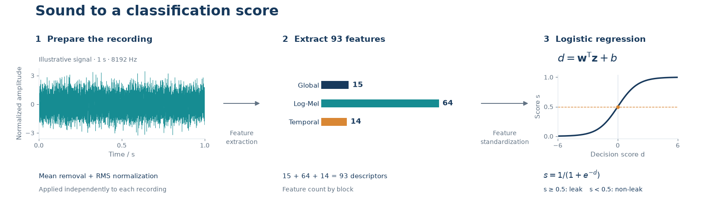

# Acoustic Leak Baseline

A small Python baseline for acoustic leak classification: 93 signal descriptors,
standardization, and L2-regularized logistic regression. Train it on your own
labeled recordings and evaluate it with recording groups kept apart.



[Vector figure](assets/overview.svg)

The package exposes ordinary NumPy arrays and a scikit-learn pipeline. It contains
no dataset-specific filenames, fixed train/test lists, or pretrained weights.

## Quick start

Python 3.11 or newer is required. In a virtual environment:

```bash
git clone https://github.com/ox10cx10/acoustic-leak-baseline.git
cd acoustic-leak-baseline
python -m pip install -e .
python -m examples.synthetic
```

The example generates several clips for each simulated recording condition,
performs grouped cross-validation, fits a model, and predicts a new clip.
Its printed scores demonstrate the workflow; they do not measure real leak detection.

## Use your recordings

Prepare these arrays after checking the labels and duplicate recordings:

| Array | Shape | Meaning |
|---|---|---|
| `signals` | `(n, 8192)` | One-second mono waveforms sampled at 8192 Hz |
| `labels` | `(n,)` | `0`: non-leak; `1`: leak |
| `groups` | `(n,)` | Nonempty strings identifying the original recording or acquisition source |

Clips cut from the same recording must share a group. Choose a grouping level
that matches the intended use: separate recording sessions for new-session
evaluation, or separate sites for new-site evaluation. Arbitrary row IDs do not
make related clips independent. Keep duplicate waveforms in one partition and
resolve conflicting labels using collection records before evaluation.

```python
import numpy as np
from acoustic_leak import cross_validate, evaluate, make_pipeline

# Your arrays; the NPZ file is not included in this repository.
with np.load("recordings.npz", allow_pickle=False) as data:
    signals, labels, groups = data["signals"], data["labels"], data["groups"]

cv = cross_validate(signals, labels, groups, C=0.1, n_splits=3)
print(cv["metrics"])

model = make_pipeline(C=0.1).fit(signals, labels)
scores = model.predict_proba(signals[:2])[:, 1]
predicted_labels = (scores >= 0.5).astype(int)
```

The final two lines illustrate prediction on supplied clips, not a test score.
For a held-out evaluation, split by group **before** choosing parameters, fit on
the training partition, then call `evaluate(y_test, model.predict_proba(X_test)[:, 1])`.
The held-out labels must not be used to choose `C`, features, or the threshold.
If you compare several `C` values using the cross-validation scores, those scores
are model-selection results rather than an independent test.

`cross_validate` evaluates one fixed `C` and returns out-of-fold `scores`, a
`folds` vector, and pooled `metrics`. It requires both classes in every training
and validation fold and stops on convergence warnings. It does not fit the final
model; use `make_pipeline(...).fit(...)` after selecting the configuration.

## Feature recipe

This release deliberately specifies one input format: **8192 Hz and 8192 samples
per clip**. It validates array dimensions and values; the caller must verify the
actual sampling rate. It does not load audio files, resample, pad, or cut recordings.
Other formats need explicit preprocessing and a newly trained model.

| Block | Dimensions | Description |
|---|---:|---|
| Global shape and spectrum | 15 | Crest factor and its logarithm, zero crossings, six spectral descriptors, six band-energy fractions |
| Log-Mel statistics | 64 | Means and standard deviations of 32 log-Mel bands |
| Temporal variation | 14 | Frame energy, spectral flux, centroid, flatness, peak concentration, and band-energy variation |

Each waveform is centered and normalized by its RMS independently. This removes
constant gain differences and retains relative temporal variation; absolute
amplitude is not retained. The short-time spectrum uses a 256-point Hann window,
a 128-point hop, and no boundary padding. Mel bands cover 20–4096 Hz. Feature
extraction learns no statistics across recordings.

The scaler and classifier are fitted together inside each training fold.
Logistic regression uses balanced class weights, L2 regularization, and the
Newton-CG solver. Smaller `C` means stronger regularization. `C=1` is an API default,
not a parameter established as optimal for a particular dataset.

To inspect the feature matrix and its ordered column names:

```python
from acoustic_leak import extract_features
features, names = extract_features(signals)
assert features.shape == (len(signals), 93)
```

## Scores and evaluation

Class 1 is a leak. Use `predict_proba(... )[:, 1] >= 0.5` for the decision rule used
by the evaluator, including an exact score of 0.5. Class weighting affects the
scores; they have not been calibrated as field leak probabilities.

Evaluation reports accuracy, balanced accuracy, leak recall, false-positive rate,
false-negative rate, ROC AUC, and a confusion matrix. Matrix rows are true labels;
columns are predicted labels, both ordered `[0, 1]`. Both classes are required.

This is a trainable baseline, not a validated detector for every pipe, sensor,
or environment. New acquisition conditions require suitable labeled recordings
and evaluation. No real-data performance claim is made by this release.

## Save and load

Save the complete pipeline so that the fitted scaler travels with the classifier:

```python
import joblib
joblib.dump(model, "model.joblib")
restored = joblib.load("model.joblib")
scores = restored.predict_proba(signals[:2])[:, 1]
```

Only load model files you trust. Keep the package and dependency versions used
for training: scikit-learn does not support loading models across arbitrary
library versions.

## Code and tests

| File | Responsibility |
|---|---|
| [features.py](acoustic_leak/features.py) | Waveform validation, normalization, and the 93 descriptors |
| [model.py](acoustic_leak/model.py) | Pipeline construction, grouped validation, and metrics |
| [synthetic.py](examples/synthetic.py) | Executable example using simulated recordings |
| [test_baseline.py](tests/test_baseline.py) | Numerical checks, group isolation, metrics, and model round trip |

```bash
python -m unittest discover -s tests -v
```

To redraw the overview figure:

```bash
python -m pip install ".[figures]"
python -m examples.plot_overview
```

## License and citation

Released under the [MIT License](LICENSE). For research use, cite the repository
and the version or commit used; [CITATION.cff](CITATION.cff) provides citation metadata.
